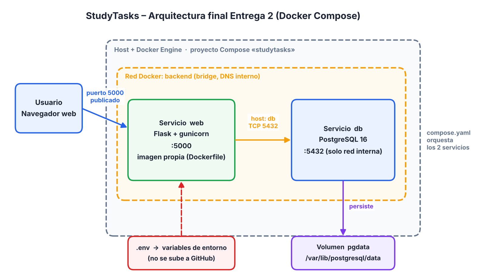

# 📚 StudyTasks

Gestor de tareas académicas (API REST + interfaz web) con **Flask** y **PostgreSQL**, orquestado con **Docker Compose**.
Proyecto de aula · SD1005 Sistemas Operativos · 2026-II.

| Entrega | Etiqueta Git | Contenido |
|---|---|---|
| 1 | `entrega-1` | App + Dockerfile propio (un contenedor, SQLite) |
| 2 | `entrega-2` | Compose con 2 servicios, red, volumen y variables de entorno |

## ¿Qué problema resuelve?
Los estudiantes manejan varias materias con fechas de entrega distintas y pierden el control de lo pendiente.
StudyTasks centraliza las tareas: se registran con materia y fecha límite, se ordenan por vencimiento, se completan y se eliminan.

## Arquitectura (Entrega 2)



- **web**: Flask + gunicorn, imagen **propia** construida con el `Dockerfile`. Publica el puerto 5000.
- **db**: PostgreSQL 16 (imagen oficial). **No** publica puertos: solo la ve `web` por la red interna.
- **Red `backend`** (bridge): `web` llega a la base de datos usando el nombre DNS `db`.
- **Volumen `pgdata`**: guarda `/var/lib/postgresql/data`, así los datos sobreviven a `docker compose down`.
- **`.env`**: credenciales y configuración (no se sube a GitHub).

## Requisitos
Solo [Docker](https://docs.docker.com/get-docker/) con el plugin Compose v2 (`docker compose version`). No se necesita Python ni PostgreSQL instalados.

## Ejecutar desde cero (Entrega 2)

```bash
# 1. Clonar
git clone <URL-DEL-REPOSITORIO>
cd studytasks

# 2. Crear el archivo de variables de entorno y cambiar la contraseña
cp .env.example .env        # en Windows (PowerShell): copy .env.example .env

# 3. Construir la imagen y levantar los servicios
docker compose up -d --build

# 4. Abrir http://localhost:5000
```

### Operación diaria
```bash
docker compose ps                 # estado de los servicios (db debe estar "healthy")
docker compose logs -f web        # logs de la aplicación (Ctrl+C para salir)
docker compose logs db            # logs de PostgreSQL
docker compose stop               # detiene sin eliminar
docker compose start              # vuelve a iniciar
docker compose restart web        # reinicia un servicio
docker compose down               # elimina contenedores y red (CONSERVA el volumen)
docker compose down -v            # ⚠️ elimina también el volumen (borra los datos)
```

## Demostrar la comunicación entre servicios
```bash
curl http://localhost:5000/api/info                       # base_de_datos: "postgresql"
docker compose exec web getent hosts db                   # el DNS de la red resuelve "db"
docker network ls                                         # red studytasks_backend
docker network inspect studytasks_backend                 # ambos contenedores conectados
docker compose exec db psql -U studytasks -d studytasks -c "SELECT * FROM tareas;"
```
Verificar que la base de datos **no** está expuesta al anfitrión: `docker compose ps` no muestra puertos publicados para `db`.

## Demostrar la persistencia
```bash
# 1) Crear una tarea desde la web o con curl
curl -X POST http://localhost:5000/api/tareas -H "Content-Type: application/json" \
     -d '{"titulo":"Persistir","materia":"SO","fecha_limite":"2026-12-01"}'

# 2) Destruir contenedores y red (el volumen NO se borra)
docker compose down
docker volume ls                  # sigue existiendo studytasks_pgdata

# 3) Recrear y comprobar que la tarea sigue
docker compose up -d
curl http://localhost:5000/api/tareas
```
Todo el flujo está automatizado en `scripts/demo_persistencia.sh` (Linux/macOS/Git Bash/WSL).

## Variables de entorno
| Variable | Uso | Valor por defecto |
|---|---|---|
| `POSTGRES_DB` | Nombre de la base de datos | *(obligatoria)* |
| `POSTGRES_USER` | Usuario de PostgreSQL | *(obligatoria)* |
| `POSTGRES_PASSWORD` | Contraseña de PostgreSQL | *(obligatoria)* |
| `APP_PORT` | Puerto del anfitrión para la web | `5000` |
| `APP_ENV` | Etiqueta de entorno mostrada en la UI | `dev` |

`compose.yaml` pasa estas variables al servicio `web` como `DB_HOST`, `DB_PORT`, `DB_NAME`, `DB_USER` y `DB_PASSWORD`.
El archivo `.env` real está en `.gitignore`; en el repositorio solo existe `.env.example` sin secretos.

## Entrega 1 (un solo contenedor, sin Compose)
Sin la variable `DB_HOST` la aplicación usa SQLite dentro del contenedor:
```bash
docker build -t studytasks:1.0 .
docker run -d --name studytasks -p 5000:5000 studytasks:1.0
docker stop studytasks && docker rm studytasks && docker rmi studytasks:1.0
```
> Con este modo los datos se pierden al eliminar el contenedor; por eso la Entrega 2 usa PostgreSQL con volumen.

## API
| Método | Ruta | Descripción |
|---|---|---|
| GET | `/` | Interfaz web |
| GET | `/health` | Estado del servicio y de la BD |
| GET | `/api/info` | Versión, contenedor, base de datos, entorno |
| GET | `/api/tareas` | Lista las tareas |
| POST | `/api/tareas` | Crea tarea `{"titulo","materia","fecha_limite":"AAAA-MM-DD"}` |
| PATCH | `/api/tareas/<id>` | Alterna completada / pendiente |
| DELETE | `/api/tareas/<id>` | Elimina la tarea |

## Estructura
```
studytasks/
├── app/                    # Flask: app.py, db.py, templates/, static/
├── tests/                  # pruebas unitarias
├── scripts/                # demo_persistencia.sh
├── docs/                   # diagramas, PDFs, guion de sustentación
├── Dockerfile              # imagen propia de la app
├── compose.yaml            # servicios web + db, red y volumen
├── .env.example            # plantilla de variables (sin secretos)
├── .dockerignore  .gitignore
├── requirements.txt
└── README.md
```

## Solución de problemas
| Síntoma | Causa / solución |
|---|---|
| `variable is not set` al hacer `up` | Falta crear `.env` (`cp .env.example .env`). |
| `port is already allocated` | El 5000 está ocupado: cambie `APP_PORT` en `.env`. |
| La web tarda en arrancar | Espera a que `db` esté *healthy* (`docker compose ps`). |
| Cambié la contraseña y falla la conexión | PostgreSQL guarda la clave en el volumen: `docker compose down -v` y volver a levantar. |

## Pruebas (opcional, sin Docker)
```bash
pip install -r requirements.txt
python -m unittest discover -s tests -v
```
